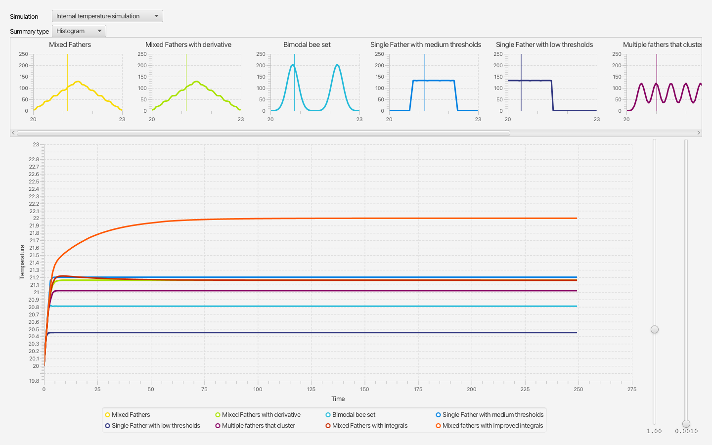
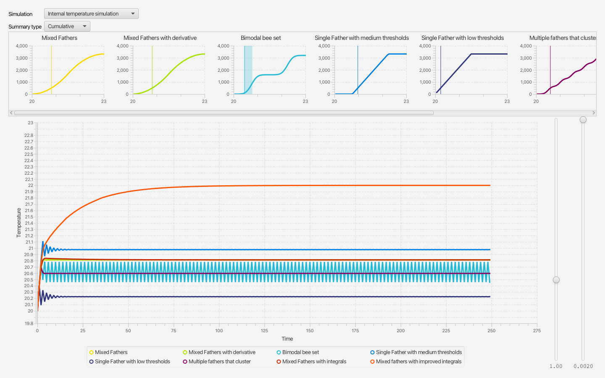
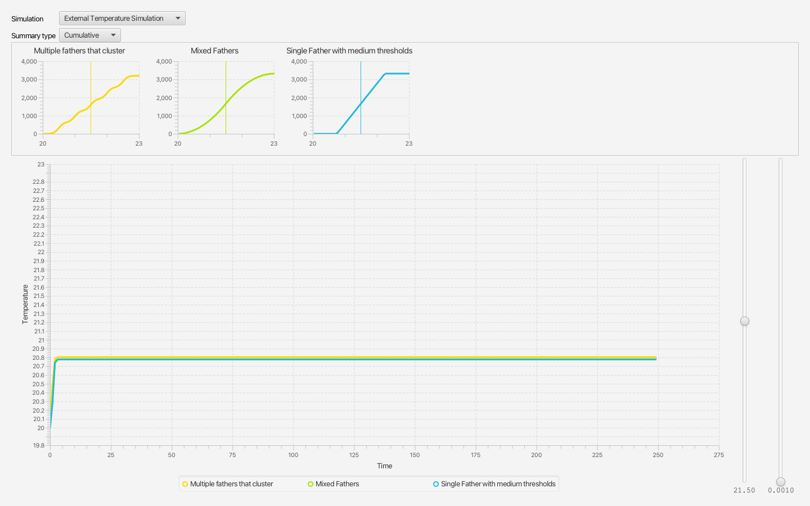

# Bee Bearding Simulator

How does a honeybee colony keep its hive at the right temperature when no bee is in charge? This simulator lets you explore one answer: every bee follows its own simple rule, and the colony's response comes from how those rules differ from bee to bee.

It accompanies **Eusocial Cooperation**, an as-yet-unpublished book by me (Jonathan Card), and is written for readers interested in emergent behavior, how human civilizations resemble insect hives, and how decentralized systems can regulate themselves. You don't need to be a programmer to use it.



## What it simulates

When a hive gets too warm, groups of bees gather at the entrance and fan their wings to move air through it, a behavior called *bearding*. The colony keeps the brood at a closely regulated temperature this way, yet no bee directs the others.

Research on honeybees (Jones et al., 2004) found that the bees that join in at different temperatures are grouped by the genetics of their fathers (all the workers share the same mother). Each bee seems to have its own temperature threshold for taking up the task. In the literature this is known as the *response threshold* model.

The simulator models exactly that:

- Each bee has a threshold. When the temperature rises above it, the bee joins the bearding; when it falls below, the bee leaves.
- Each active bee removes a little heat; heat also flows into the hive.
- Step by step, the temperature changes with the balance between the two, and each bee decides again.

Different populations of bees are built in, with their thresholds spread in different ways: daughters of many fathers mixed together, a single father, two or several clusters, normal distributions, and bees that also react to how fast the temperature is changing or to how long it has been too warm.
There are some assumptions that don't necessarily match reality; my interest is in examining the algorithm, not actual bees. The most important possibly-silly assumption is that the daughters of a particular father will have temperature thresholds linearly centered around the father's threshold. Like I said, this may be silly, but even in this case the more fathers there are the more the distribution of the entire hive will become normally distributed. You can start to see that in the populations labelled "Multiple Fathers"; these are multiple linear distributions layered on top of each other, and the populations are starting to look more bell-shaped already. Some of the population shapes are basically chosen creatively; there's every chance that such populations can't exist in reality.

There are two simulations:

- **Internal temperature:** bees react to the temperature inside the hive, and heat flows in at a rate you set.
- **External temperature:** bees react to the temperature outside the hive, and heat flows in through the hive walls according to the difference between the outside and inside temperatures.

## What it shows

Without any bee knowing the "right" temperature, the colony settles at a stable temperature. The more heat flows in, the more bees it takes to balance it, and the higher the temperature at which enough of them have joined. The shape of the population's thresholds decides how the colony responds.

In control-engineering terms, this works like a proportional (P) controller, or a proportional-derivative (PD) controller with the bees that react to the rate of change. These leave a *steady-state error*: the hive settles at a temperature that depends on how much heat is coming in. Removing that error normally needs an integral term, which in turn needs a shared idea of the target temperature. Without shared knowledge of an "optimal" temperature, there is no way for individual bees to decide whether to keep bearding below their own threshold to counter the outside pressure.

One interesting note here is that, unlike PID, this algorithm doesn't work without external forcing, at least in this form where the choice is between "participate" and "don't participate". If there is no external forcing pushing the temperature above the threshold, the result of not participating doesn't raise the temperature. Bees do regulate the temperature of the hive when it drops too low, but it's with a different task (generating body heat within the hive by, basically, going into the nursery and exercising). So for this application, this is correct behavior, because that would require a different distribution of task-join preferences to behave properly. But notice that when the Heat In slider is set to 0, the temperature of the hive stays at 0, not a stable temperature. So, in a PID controller, the absence of external forcing allows a system without an *I* term to equalize at its set point and the presence of external forcing introduces steady-state error, but in the case of Threshold Response the absence of external forcing prohibits the system from finding an equilibrium at all so what I am referring to as steady-state error is similar, but not exactly the same, as it is in the PID algorithm (apart from the fact that, without a set point defined, the quantity of "error" isn't definable).

By adjusting the Heat In slider and the Heat Per Bee slider, you can observe the different ways the system stabilizes. By increasing the heat, the stable temperature of the hive drifts upwards, but at different rates. This rate is the equivalent of the *steady-state error* described above. The rate at which the stable temperature changes compared to the Heat In slider changes is based on the slope of the Cumulative Distribution Function (CDF) of the probability distribution of the thresholds (which is the same as the height of the Probability Density Function (PDF). The PDF and the CDF are equations that correspond to the Histogram and Cumulative view of the bee populations in the UI, although strictly speaking the UI is based on the bee populations used in the simulation, not plots of the equations themselves). Populations with spikes in the thresholds (like the one labelled "Bimodal bee set") will see the stable temperature shoot upwards when the heat flow increases beyond a certain point, whereas the linear distributions like "Single Father with medium thresholds" and "Single Father with low thresholds" increase at the same constant rate, but the population with low thresholds stabilizes at a lower temperature. In the population called "Normal distribution, narrow", even at the lowest "Heat Flow per Bee" setting, the temperature cannot settle at an equilibrium because the slope of the CDF is so steep the system over-corrects around the mean of the distribution so, while it is the most stable of the populations that can't incorporate an *I* term, it would only settle with a larger population of bees that each contribute less (and I will re-iterate: none of these values are meant to be taken literally. This is not the actual mass of a hive, this is not the actual amount of heat flow an individual bee contributes to a bearding, this is not the actual specific heat of a hive, etc. I wanted to study the impact of different distributions on the algorithm behavior, and as such I chose values that showed that, and chose stand-in values to make the numbers look real-ish to make it easier to understand by looking like real numbers. In fact, even choosing the low 20s for the temperature is wrong; actual beehive temperatures sure stabilize around 35 degrees.)

The populations with "improved integrals" in the label are cheats (sort of). It manages to eliminate the steady-state error and maintain stability, but it relies on the population (descended from many fathers, all of whom are probably from different hives from each other, etc.) all inheriting a shared knowledge of what the "optimal" temperature is for a hive, but they also inherit different thresholds for when they join the bearding or not. This may be true; humans all have a universally shared "knowledge" of what our body temperatures should be (the standard deviation of human body temperatures appears to be about 0.35 C (Ley et al., 2023), which is similar to the required maximum temperature deviation in beehives, +/- 0.5 C (Jones et al, 2004; Kronenberg & Heller, 1982; Stabentheiner et al. 2010, 2021; all as quoted in Godeau et al, 2023)). It would require the bees to use a different value for the hive being "too hot" than they use for "I should do something about it being too hot" (believable) and for evolution to have produced a species-wide very narrow diversity in the "too hot" value, and to have specifically evolved wider probability distributions in the values of the task activation value, which would be fascinating to know if that's possible. On first blush, that would go in the face of the "Selfish Gene" approach made famous by Richard Dawkins in his book by that name that contests whether "group selection" is possible in favor of "group selection" that is often seen as championed by the late E. O. Wilson, but I'm not sure it necessarily would (I know very little about genetics and evolutionary biology, and eusocial insects have different genetics than we are generally taught in school in complicated ways). A queen in a hive with a distribution in her children that is too narrow would die (the temperature might oscillate and fail to stabilize), a queen in a hive with a distribution in her children that is too wide would not be able to stabilize the temperature sufficiently (temperature would vary too widely), and a queen in a hive with a distribution in her children that has the wrong mean would die (the temperature of the hive would stabilize at the wrong value), and the cost to an individual worker for having a different threshold than her sisters wouldn't give it preferment for reproduction, as the individual workers don't reproduce. The largest effect would be if a bee joins the bearding too often or too infrequently and this is extra-strenuous or less-strenuous work, limiting the lifespan differently of worker bees with different thresholds. But this would be functionally be the same as changing the shape of the distribution and wouldn't prevent the mechanism from working or change whether evolution could produce a specific distribution. The question is: would the fathers from a hive survive preferentially by having a *particular* threshold that only contributes to the *distribution* of thresholds in his daughter-queen's daughters. I have no idea. (I'm reminded of the [Founder Effect](https://en.wikipedia.org/wiki/Founder_effect), where a trait can breed true in a population particularly because it has no effect on survival)

The simulation named "External Temperature Simulation" relies on the bees responding to the temperature outside the hive rather than the temperature inside the hive. This approach did eliminate steady-state error without an *I* term, but it relied on the bees responding to the outside temperature with evolutionary pressure tuning the variables rather than negative feedback, so it probably isn't a realistic solution. If the distribution of the bees' thresholds matches other variables, such as the rate at which heat flows through the hive walls, then the graduated response of the population can match the change in heat flow caused by the difference between the outside and inside temperatures. This shows that a solution to steady-state error may exist from Threshold Response without an equivalent to an *I* term, but it isn't a good proposition of how actual bees regulate their hive temperatures.

## Reading the screen

- **Population charts (top):** one per population, colored to match its line in the temperature chart. Each summarizes the bees' thresholds, either as a **histogram** (how many bees have a threshold in each small temperature range) or as a **cumulative** distribution (how many bees have a threshold below each temperature). Scroll sideways to see them all. All the charts share the same vertical scale, so they can be compared.
- **Indicator:** the vertical line on each population chart marks where its simulation ended up: the final hive temperature (internal simulation) or the outside temperature (external simulation). For the populations of simple bees, the height where the line crosses the cumulative curve is the number of bees bearding.
- **Band:** when a simulation never settles and keeps swinging up and down, a shaded band around the indicator shows the range of temperatures it was still swinging over at the end.
- **Temperature chart (bottom):** the hive temperature over time for every population.
- **Sliders (right):** the heat flowing in (or, in the external simulation, the outside temperature) and the heat each bearding bee removes. Drag them and watch the charts follow.
- **Steps slider (under the temperature chart):** how many steps each simulation runs, from 10 to 250. Fewer steps stretch the start of each run across the chart, which shows how the populations first respond.
- **Simulation and Summary type (top left):** switch between the two simulations and between histogram and cumulative charts.





## Running the simulator

There is no formally packaged download yet, so the simulator is run from its source code (you may be able to get jar file from the most recent merge into master):

1. Install a recent Java Development Kit (JDK 25 is used for development), for example from [Adoptium](https://adoptium.net/).
2. Install [sbt](https://www.scala-sbt.org/download/), the Scala build tool.
3. Download or clone this repository, open a terminal in its folder, and run:

   ```sh
   sbt run
   ```

   The first run downloads Scala, ScalaFX and JavaFX, which takes a few minutes.

## Known limitations

- **The numbers are illustrative, not measurements.** The constants are chosen to give realistic-looking temperatures in degrees Celsius from realistic-looking heat inputs, but the population size was chosen to be a round number, and values such as the hive's specific heat and each bee's cooling ability were chosen to fit. The simulator shows that emergent behavior *can* regulate temperature this way; it doesn't model a particular real hive.
- **The populations are built in.** New populations can be added by a programmer (see [CONTRIBUTING.md](CONTRIBUTING.md)), but not from within the application.
- **The slider ranges don't reach every population's extremes.** At the top of the heat slider, most populations still haven't reached their limits, and the temperature chart's scale is fixed.
- **It has to be built from source** and needs a recent JDK. (A packaged jar file may be found in the most recent merge to master, but we don't have formal releases with fixed milestones and guaranteed stability)

## For developers

```sh
sbt test    # run all tests; the UI tests run headlessly, without opening windows
```

See [CONTRIBUTING.md](CONTRIBUTING.md) for how to contribute and `CLAUDE.md` for an overview of the code. The screenshots above are rendered from the real application, headlessly, with:

```sh
sbt "Test/runMain beesimulator.ui.ReadmeScreenshots docs/images"
```

## References

Godeau, Ugoline & Pioz, Maryline & Martin, Olivier & Rüger, Charlotte & Crauser, Didier & Le Conte, Yves & Henry, Mickaël & Alaux, Cédric. (2023). Brood thermoregulation efficiency is positively linked to the amount of brood but not to the number of bees in honeybee colonies. 10.32942/osf.io/9mwye. 

Jones, Julia C., Mary R. Myerscough, Sonia Graham, and Benjamin P. Oldroyd. 2004. "Honey Bee Nest Thermoregulation: Diversity Promotes Stability." *Science* 305: 402–404. <https://doi.org/10.1126/science.1096340>

Kronenberg, F., Heller, H.C. Colonial thermoregulation in honey bees (Apis mellifera). Journal of Comparative Physiology B 148, 65–76 (1982). https://doi.org/10.1007/BF00688889

Ley C, Heath F, Hastie T, Gao Z, Protsiv M, Parsonnet J. Defining Usual Oral Temperature Ranges in Outpatients Using an Unsupervised Learning Algorithm. JAMA Intern Med. 2023;183(10):1128–1135. doi:10.1001/jamainternmed.2023.4291 <https://jamanetwork.com/journals/jamainternalmedicine/fullarticle/2809098>

Stabentheiner A, Kovac H, Brodschneider R (2010) Honeybee Colony Thermoregulation – Regulatory Mechanisms and Contribution of Individuals in Dependence on Age, Location and Thermal Stress. PLoS ONE 5(1): e8967. https://doi.org/10.1371/journal.pone.0008967

Stabentheiner A, Kovac H, Mandl M, Käfer H. Coping with the cold and fighting the heat: thermal homeostasis of a superorganism, the honeybee colony. J Comp Physiol A Neuroethol Sens Neural Behav Physiol. 2021 May;207(3):337-351. doi: 10.1007/s00359-021-01464-8. Epub 2021 Feb 17. PMID: 33598719; PMCID: PMC8079341

## License

This project is licensed under the [Apache License 2.0](LICENSE). Unless you say otherwise, any contribution you submit for inclusion is licensed under the same terms, as described in section 5 of the license.
