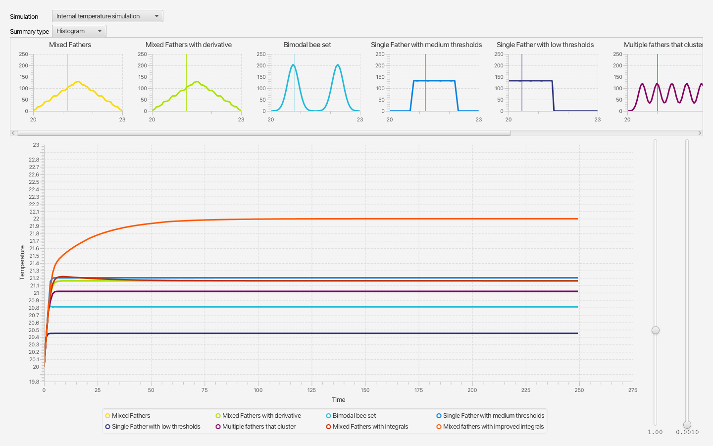
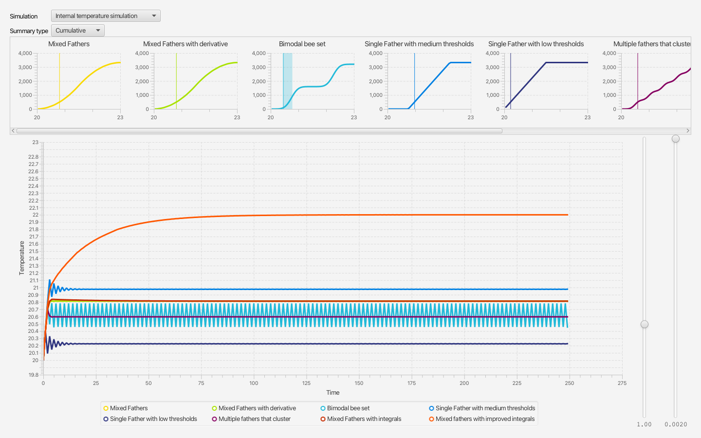
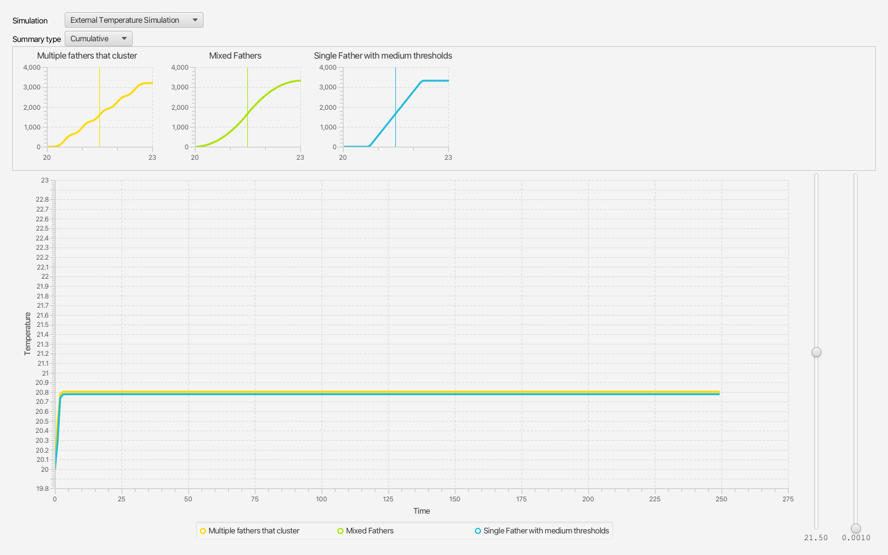

# Bee Bearding Simulator

How does a honeybee colony keep its hive at the right temperature when no bee is in charge? This simulator lets you explore one answer: every bee follows its own simple rule, and the colony's response comes from how those rules differ from bee to bee.

It accompanies **[BOOK TITLE: author to fill in]**, and is written for readers interested in honeybees, emergent behaviour, or how decentralised systems can regulate themselves. You don't need to be a programmer to use it.



## What it simulates

When a hive gets too warm, groups of bees gather at the entrance and fan their wings to move air through it, a behaviour called *bearding*. The colony keeps the brood at a closely regulated temperature this way, yet no bee directs the others.

Research on honeybees [CITATION: author to fill in] found that the bees that join in at different temperatures are grouped by the genetics of their fathers (all the workers share the same mother). Each bee seems to have its own temperature threshold for taking up the task. In the literature this is known as the *response threshold* model.

The simulator models exactly that:

- Each bee has a threshold. When the temperature rises above it, the bee joins the bearding; when it falls below, the bee leaves.
- Each active bee removes a little heat; heat also flows into the hive.
- Step by step, the temperature changes with the balance between the two, and each bee decides again.

Different populations of bees are built in, with their thresholds spread in different ways: daughters of many fathers mixed together, a single father, two or several clusters, and bees that also react to how fast the temperature is changing or to how long it has been too warm.

There are two simulations:

- **Internal temperature:** bees react to the temperature inside the hive, and heat flows in at a rate you set.
- **External temperature:** bees react to the temperature outside the hive, and heat flows in through the hive walls according to the difference between the outside and inside temperatures.

## What it shows

Without any bee knowing the "right" temperature, the colony settles at a stable temperature. The more heat flows in, the more bees it takes to balance it, and the higher the temperature at which enough of them have joined. The shape of the population's thresholds decides how the colony responds.

In control-engineering terms, this works like a proportional (P) controller, or a proportional-derivative (PD) controller with the bees that react to the rate of change. These leave a *steady-state error*: the hive settles at a temperature that depends on how much heat is coming in. Removing that error normally needs an integral term, which in turn needs a shared idea of the target temperature. Without shared knowledge of an "optimal" temperature, there is no way for individual bees to decide whether to keep bearding below their own threshold to counter the outside pressure.

One approach did eliminate steady-state error, but it relied on the bees responding to the outside temperature rather than the temperature inside the hive, with evolutionary pressure tuning the variables rather than negative feedback, so it may not be stable. If the distribution of the bees' thresholds matches other variables, such as the rate at which heat flows through the hive walls, then the graduated response of the population can match the change in heat flow caused by the difference between the outside and inside temperatures. This shows that a solution to steady-state error may exist from emergent behaviour, but the data from real hives that I have seen is too noisy to tell whether real hives have steady-state error or not.

## Reading the screen

- **Population charts (top):** one per population, coloured to match its line in the temperature chart. Each summarises the bees' thresholds, either as a **histogram** (how many bees have a threshold in each small temperature range) or as a **cumulative** distribution (how many bees have a threshold below each temperature). Scroll sideways to see them all. All the charts share the same vertical scale, so they can be compared.
- **Indicator:** the vertical line on each population chart marks where its simulation ended up: the final hive temperature (internal simulation) or the outside temperature (external simulation). For the populations of simple bees, the height where the line crosses the cumulative curve is the number of bees bearding.
- **Band:** when a simulation never settles and keeps swinging up and down, a shaded band around the indicator shows the range of temperatures it was still swinging over at the end.
- **Temperature chart (bottom):** the hive temperature over time for every population.
- **Sliders (right):** the heat flowing in (or, in the external simulation, the outside temperature) and the heat each bearding bee removes. Drag them and watch the charts follow.
- **Simulation and Summary type (top left):** switch between the two simulations and between histogram and cumulative charts.





## Running the simulator

There is no packaged download yet, so the simulator is run from its source code:

1. Install a recent Java Development Kit (JDK 25 is used for development), for example from [Adoptium](https://adoptium.net/).
2. Install [sbt](https://www.scala-sbt.org/download/), the Scala build tool.
3. Download or clone this repository, open a terminal in its folder, and run:

   ```sh
   sbt run
   ```

   The first run downloads Scala, ScalaFX and JavaFX, which takes a few minutes.

## Known limitations

- **The numbers are illustrative, not measurements.** The constants are chosen to give realistic-looking temperatures in degrees Celsius from realistic-looking heat inputs, but the population size was chosen to be a round number, and values such as the hive's specific heat and each bee's cooling ability were chosen to fit. The simulator shows that emergent behaviour *can* regulate temperature this way; it doesn't model a particular real hive.
- **The populations are built in.** New populations can be added by a programmer (see [CONTRIBUTING.md](CONTRIBUTING.md)), but not from within the application.
- **The slider ranges don't reach every population's extremes.** At the top of the heat slider, most populations still haven't reached their limits, and the temperature chart's scale is fixed.
- **It has to be built from source** and needs a recent JDK.

## For developers

```sh
sbt test    # run all tests; the UI tests run headlessly, without opening windows
```

See [CONTRIBUTING.md](CONTRIBUTING.md) for how to contribute and `CLAUDE.md` for an overview of the code. The screenshots above are rendered from the real application, headlessly, with:

```sh
sbt "Test/runMain beesimulator.ui.ReadmeScreenshots docs/images"
```

## License

[LICENSE: author to choose]
